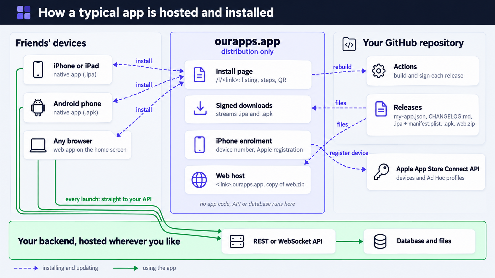

# ourapps - a private installer for apps you build for friends

Nobody browses here. A developer sends a friend a link or a QR code; the friend taps it and
the app lands on their home screen. No App Store, no Google Play, no accounts for friends.

- iPhone: Apple Ad Hoc over-the-air. The friend registers their phone once (a small
  profile), the developer approves it, the app's repository builds a copy that includes
  that phone, and the friend taps Install.
- Android: a direct APK download with a one-time walkthrough of the "allow from this
  source" and Play Protect prompts.
- Web apps: an "add to home screen" walkthrough when the app lists a web version.

## Two faces

- Friends see an App Store style page at `/l/<id>`: icon, tagline, facts strip, screenshots,
  about, what's new, privacy, information, share. Blank fields get generated placeholders so a
  bare listing still looks finished. The page detects iPhone, Android, desktop and in-app
  browsers and shows the right install steps.
- Developers see a console at `/dev`: overview with a setup checklist and stats, apps, share
  links with QR codes, devices, settings, an A to Z guide, and an agents page with API keys
  and prompts. Signed-in developers see an owner bar on their own install pages.

## Agents and the API

Everything the console does is an API. Create a key on `/dev/agents` (shown once, `oa_...`),
send it as `Authorization: Bearer`, and read https://ourapps.app/agents.md for every
endpoint. `/dev/agents` also carries two prompts to paste into a coding agent: one sets up an
app repository to the contract, one drives the console (register, check releases, share,
approve). `llms.txt` points agents at both documents.

## Security and terms

The guide's Security section (`/dev/guide#security`) explains how credentials, account access,
friends' iPhone records and app files are protected. Developers accept the terms and data
statement (`/terms`, version in `shared/src/terms.ts`) at first sign-in and after any change;
the accepted version is shown in the profile, which also offers account deletion.

Credentials are encrypted field by field (AES-256-GCM, key derived per developer from a Worker
secret, authenticated data binding each field to its owner); API keys, build tokens and session
ids are stored as keyed hashes; credential writes need a browser session; API keys have scopes
and expiry; every security event is logged and visible under Settings. Rotation and incident
steps: `SECURITY.md`.

## Layout

| path       | what                                                            |
|------------|-----------------------------------------------------------------|
| `worker/`  | Cloudflare Worker: sign-in, dashboard API, enrolment, build hooks, artefact proxy |
| `site/`    | Vite + TypeScript site served by the worker                      |
| `shared/`  | my-app.json validation and the enrolment state machine           |
| `site/public/agents.md` | API reference for agents, served at /agents.md            |
| `CONTRACT.md` | what an app repository must implement                         |

## What kinds of app



Native iPhone and Android apps (and anything that compiles to them), static web apps and web
games served by ourapps, and server-rendered web apps linked from it. ourapps never hosts an
app's API or database. Details and limits: `/reference` (source `site/src/pages/reference.ts`);
the diagrams by app type are in `site/public/reference/` (PNG masters, WebP for the site),
generated from the prompts in `docs/diagram-prompts.md`.

## Who does what

Only a few steps need a human: signing in with GitHub, creating the GitHub token and the Apple
App Store Connect key, the one-time Apple portal setup per iPhone app (App ID, distribution
certificate, Ad Hoc profile), creating an API key for the agent, approving iPhones by name, and
sending links to people. Everything else (registering the app, the release workflow, releases,
share links, checks) is done by a coding agent with the prompts on `/dev/agents`. The guide's
TL;DR at `/dev/guide#tldr` is the definitive list.

## Add an app

1. Sign in with GitHub at `/dev`.
2. Settings: paste your App Store Connect API key (issuer id, key id, `.p8` contents), your
   Apple team id, and a GitHub fine-grained token with Contents read and write on the app's
   repository. They are stored encrypted per account.
3. Create the Ad Hoc provisioning profile once in the Apple developer portal (any name).
4. Add the app: name, repository `owner/name`, that profile name, and the App Store style
   details (tagline, description, screenshots, privacy summary). Copy the build token
   shown once into the repository secret `STORE_BUILD_TOKEN`.
5. Make the repository follow `CONTRACT.md`: publish releases with `my-app.json` and
   `CHANGELOG.md` (its sections become the revision history friends see), listen for
   `my-store-rebuild`, call `/api/build-ready`.
6. Create a share link for the app and send it, or show the QR code.

The in-app guide at `/dev/guide` covers all of this with exact clicks, including how to create
the Apple key, the GitHub token and the Ad Hoc profile.

## Share

Each share link is `/l/<random id>`. Give it a label (who it is for), an optional expiry,
and revoke it any time. The install page detects iPhone, Android or desktop and shows the
right steps. In-app browsers (Instagram, Facebook, Gmail) cannot install; the page tells
the friend to open it in Safari or Chrome.

Your public page `/<your-slug>` lists only apps you switch on, details only, no install
links, and is marked noindex.

## Limits you must know

- Apple registers at most 100 iPhones per developer per membership year, across all of
  that developer's apps. Removing a device does not free the slot until renewal. Approve
  devices for people, not for tests. Android and web apps have no device limit.
- Nothing auto-updates. Friends tap Update; an app can offer it by polling
  `/api/public/links/<id>/latest` (see the guide, "Auto-update").
- Ad Hoc builds stop launching when the provisioning profile expires, one year after it is
  created. Before that date, rebuild and publish a new release; friends install the update
  from the same link. The app page in the dashboard shows the current expiry.
- Install links for the APK and the manifest are signed and last one hour; the install
  page makes fresh ones every time it loads.

## Develop

```
npm install
npm test                       # shared, worker (vitest with the Cloudflare plugin), site
npm run typecheck
cd worker && npx wrangler d1 migrations apply app-game-store --local
npm run build -w site && npm run dev -w worker      # http://localhost:8787
```

Copy `worker/.dev.vars.example` to `worker/.dev.vars` for local secrets. GitHub sign-in
needs an OAuth App whose callback is `<PUBLIC_ORIGIN>/api/auth/callback`.

## Deploy

```
cd worker
npx wrangler d1 create app-game-store          # paste the id into wrangler.jsonc
npx wrangler d1 migrations apply app-game-store --remote   # also after adding a migration
npx wrangler secret put LINK_SECRET
npx wrangler secret put MASTER_KEY             # openssl rand -hex 32; rotation in SECURITY.md
npx wrangler secret put GITHUB_OAUTH_CLIENT_ID
npx wrangler secret put GITHUB_OAUTH_CLIENT_SECRET
npm run build -w site && npx wrangler deploy
```

`PUBLIC_ORIGIN` in `wrangler.jsonc` must match the deployed host; change it when the
custom domain is attached.

Copyright Level N Ltd 2026.
